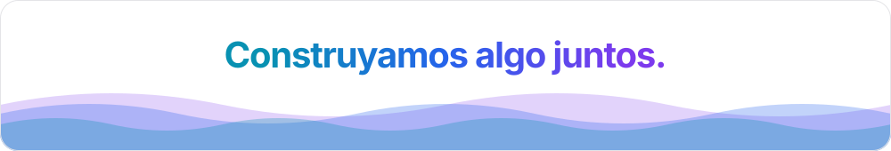

[English](README.md) | Español

<picture>
  <source media="(prefers-color-scheme: dark)" srcset="assets/hero-dark-es.svg">
  
</picture>

Desarrollador full-stack. Trabajo en todo el recorrido de un producto: ingesta y estructuración de datos, IA como una etapa más del procesamiento, exposición mediante una API y la interfaz por encima. TypeScript y React por un lado, Python y PostgreSQL por el otro.

También estoy terminando un Ciclo Formativo de Grado Superior en Desarrollo de Aplicaciones Web (DAW).

## Construyendo ahora

### NotiTech

[notitech.tech](https://notitech.tech)

El contenido tecnológico está repartido en demasiadas fuentes para seguirlo. NotiTech es un radar tecnológico: recoge contenido de varias fuentes y usa IA para clasificarlo y resumirlo, convirtiendo un flujo en bruto en información organizada y fácil de leer.

<picture>
  <source media="(prefers-color-scheme: dark)" srcset="assets/notitech-flow-dark-es.svg">
  
</picture>

- **Pipeline.** La ingesta, el procesamiento con IA y el almacenamiento ocurren antes de que nada llegue a la interfaz, así que la API sirve contenido que ya está estructurado.
- **IA como etapa.** Clasificar y resumir son un paso más del pipeline, y los resultados se guardan en PostgreSQL a través de Supabase.
- **Servicios separados.** Un backend FastAPI se sitúa entre los datos y un frontend Next.js / TypeScript, con Docker para el entorno.

Estado: en producción y en desarrollo activo.

## Otros proyectos

<table>
  <tr>
    <td width="50%">
      <a href="http://dawscape.fun">
        <picture>
          <source media="(prefers-color-scheme: dark)" srcset="assets/card-dawscape-dark-es.svg">
          
        </picture>
      </a>
    </td>
    <td width="50%">
      <a href="https://yosethlopez.es">
        <picture>
          <source media="(prefers-color-scheme: dark)" srcset="assets/card-portfolio-dark-es.svg">
          
        </picture>
      </a>
    </td>
  </tr>
</table>

<!-- TODO(Yoseth): añade qué parte concreta de DAWSCAPE desarrollaste, si quieres indicarlo. No se ha rellenado a propósito. -->
DAWSCAPE incluye además diplomas personalizados y un sistema de valoraciones, todo bajo una estética de terminal. Proyecto en equipo de 8 compañeros en XTART; fui uno de los tres desarrolladores principales.

## Stack

<picture>
  <source media="(prefers-color-scheme: dark)" srcset="assets/stack-dark-es.svg">
  
</picture>

## Explorando

- **Sistemas de IA.** LLMs con embeddings y RAG para trabajar sobre datos reales, y agentes que pueden usar herramientas.
- **Infraestructura.** Linux y despliegue: ejecutar lo que construyo, no solo escribirlo.
- **Ciberseguridad.** Donde quiero especializarme a largo plazo.

## Actividad

<picture>
  <source media="(prefers-color-scheme: dark)" srcset="https://raw.githubusercontent.com/Yoseth16/Yoseth16/output/github-snake-dark.svg">
  
</picture>

<picture>
  <source media="(prefers-color-scheme: dark)" srcset="assets/footer-dark-es.svg">
  
</picture>

  <a href="https://yosethlopez.es">yosethlopez.es</a> ·
  <a href="https://www.linkedin.com/in/yoseth-trejos">LinkedIn</a> ·
  <a href="mailto:yosethtrejos16@gmail.com">yosethtrejos16@gmail.com</a>

