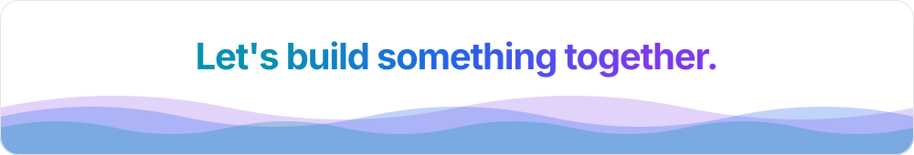

<picture>
  <source media="(prefers-color-scheme: dark)" srcset="assets/hero-dark.svg">
  
</picture>

Full-stack developer. I work across the whole path of a product: ingesting and structuring data, adding AI as a processing stage, exposing it through an API, and building the interface on top. TypeScript and React on one side, Python and PostgreSQL on the other.

I'm also completing a Higher Degree in Web Application Development (DAW).

## Currently building

### NotiTech

Technology content is spread across too many sources to follow. NotiTech is a tech radar: it collects content from multiple sources and uses AI to classify and summarize it, turning a raw stream into organized, readable information.

<picture>
  <source media="(prefers-color-scheme: dark)" srcset="assets/notitech-flow-dark.svg">
  
</picture>

- **Pipeline.** Ingestion, AI processing and storage happen before anything reaches the interface, so the API serves content that is already structured.
- **AI as a stage.** Classification and summarization are one step of the pipeline, and the results are stored in PostgreSQL through Supabase.
- **Separated services.** A FastAPI backend sits between the data and a Next.js / TypeScript frontend, with Docker for the environment.

Status: in active development.

## Other work

<table>
  <tr>
    <td width="50%">
      <a href="http://dawscape.fun">
        <picture>
          <source media="(prefers-color-scheme: dark)" srcset="assets/card-dawscape-dark.svg">
          
        </picture>
      </a>
    </td>
    <td width="50%">
      <picture>
        <source media="(prefers-color-scheme: dark)" srcset="assets/card-portfolio-dark.svg">
        
      </picture>
    </td>
  </tr>
</table>

DAWSCAPE also includes personalized diplomas and a rating system, all under a terminal aesthetic.

## Stack

<picture>
  <source media="(prefers-color-scheme: dark)" srcset="assets/stack-dark.svg">
  
</picture>

## Exploring

- **AI systems.** LLMs with embeddings and RAG to work over real data, and agents that can use tools.
- **Infrastructure.** Linux and deployment: running what I build, not only writing it.
- **Cybersecurity.** Where I want to specialize longer term.

## Activity

<picture>
  <source media="(prefers-color-scheme: dark)" srcset="https://raw.githubusercontent.com/Yoseth16/Yoseth16/output/github-snake-dark.svg">
  
</picture>

<picture>
  <source media="(prefers-color-scheme: dark)" srcset="assets/footer-dark.svg">
  
</picture>

  <a href="https://www.linkedin.com/in/yoseth-trejos">LinkedIn</a> ·
  <a href="mailto:yosethtrejos16@gmail.com">yosethtrejos16@gmail.com</a>

